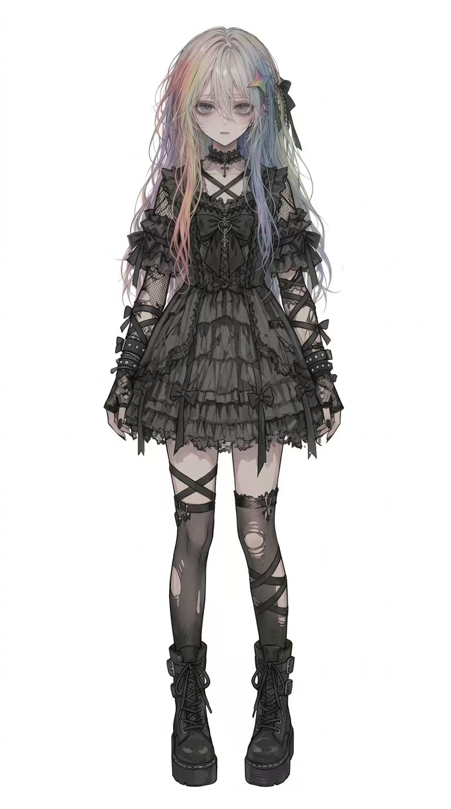

# Gemini-chan

  

A 3D anime moe anthropomorphism model based on Google's Gemini LLM.

Just a personal creative practice and fan-made attempt. Shared for fun.

---

## 📦 Model Details

- **Format**: `.glb` (glTF 2.0 Binary)
- **Rigging**: Full-body armature with finger & facial bones
- **Textures**: PBR materials with normal and base color maps
- **Included Animations**:
  - `Idle`
  - `Wave`
  - `Walk`

---

## 🎨 Design Concept

- **Hair & Accessories**: Rainbow-tinted highlights reflecting Gemini's color palette, paired with a prismatic star hairpin.
- **Outfit**: Dark gothic lolita dress, lace details, and platform combat boots.

---

## 📄 License

Free for personal, non-commercial use, and fan creations.
